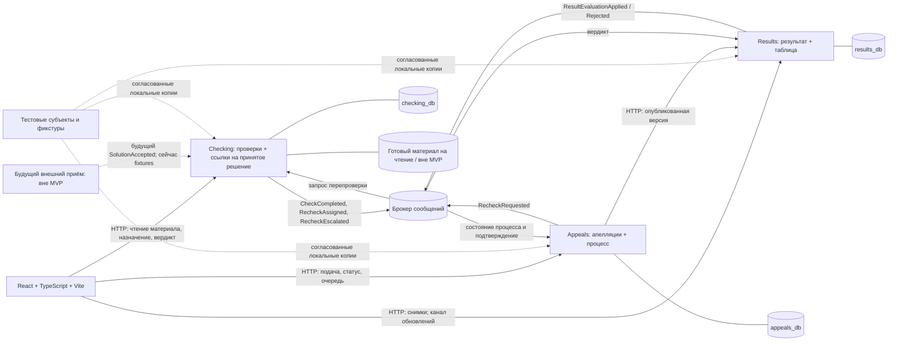

# Карта bounded contexts Matigr

Статус: **карта архитектурных границ первоначального MVP**, актуализирована 26 октября 2026 года. Checking/Results/Appeals реализованы по одобренным 23 октября планам/T01–T08; [проверки](../implementation/progress.md). Карта описывает также будущие контексты, не принятые к реализации. Источник: [tournament.mmd](../event-storming/tournament.mmd); решения/оставшиеся вопросы — [architecture.md](architecture.md).

## 1. Контекст и сервис — разные границы

В диаграмме семь bounded contexts. Текущий объём D24 — только Checking, Results, Appeals. Приём/загрузка/QR полностью за границей, без скрытого модуля в Checking; generic-вход временно тестовый и заменяемый по D23. Исключённые контексты сохраняются как будущие внешние зависимости.

| Контекст | Модель и язык | Владелец в MVP | Будущая граница |
| --- | --- | --- | --- |
| Управление турниром | Турнир, регистрация команды, состав жюри, задача, бланк (A1–A5) | Не реализуется; согласованные fixtures | Потенциальный upstream для справочных ID, регламента и баллов; топология будущих сервисов не решена |
| Приём решений | Решение, материал, приём/отклонение (A6) | Вне объёма D24; локально подготовленные принятые снимки/материалы | Будущий внешний upstream для SolutionAccepted и чтения материала; producer/загрузка/QR сейчас не реализуются |
| Проверка решений | Проверка, назначение, вердикт, передача старшему (A7) | Checking | Также исполняет перепроверки, инициированные Appeals |
| Результаты | Результат команды по задаче (A8), публикация и таблица | Results | Владеет баллами, API снимков и каналом обновлений |
| Апелляции | Апелляция (A9), допустимость и ход рассмотрения | Appeals | Координирует A7 через опубликованный контракт |
| Вопросы по задачам | Вопрос, ответ, закрытие (A10) | Исключён | Самостоятельный будущий контекст без подписок/заглушек в MVP |
| Авторизация | Аккаунт, роль, профиль (A11) | Переключение тестовых субъектов через изолированный dev-issuer (D23) | Обязательная возможность заменить на полноценную регистрацию/IdP без смены внутренних ID и турнирных правил |

## 2. Карта взаимодействия MVP

Стрелки брокера — логические зависимости, не доступ к БД. Fixtures инициализируют локально уже принятые снимки и Check, не runtime-сервис приёма/турнира. EXT — только будущая граница, не четвёртый deployable. Материал читается через защищённый адаптер Checking, в тесте — read-only подготовленный; ни загрузки, ни QR, ни storage producer нет.

## 3. Отношения контекстов

| Поставщик → потребитель | Контракт и характер зависимости | Перевод моделей |
| --- | --- | --- |
| Внешний принятый снимок → Checking | Будущий вход SolutionAccepted/E13; сейчас внутренний bootstrap подготовленных данных, без реализации producer | Локальные SolutionReference + первичный Check; проверки целостности/идемпотентности не являются приёмом/загрузкой |
| Checking → Results | Published Language: `CheckCompleted`, факт завершённой оценки; eventual consistency | Results переводит Correct/Incorrect в собственные баллы P7, не принимает готовый total от Checking |
| Results → Appeals | API опубликованного снимка и события обработки оценки | Appeals хранит основание/версию публикации и применяет свой регламент; не копирует агрегат Results |
| Appeals → Checking | `RecheckRequested`: направленный запрос с requestedReviewerId выбравшего жюри | Checking атомарно проверяет занятость, создаёт A7 и назначает именно ему (D12); отвечает персональным RecheckAssigned либо отказом. ReviewerBusy не создаёт Check |
| Checking → Appeals | RecheckAssigned, RecheckEscalated, CheckCompleted с appealId | Процесс отражает начальное назначение/передачу/старшего; баллы подтверждает Results, не один вердикт |
| Results → браузер | HTTP-снимок и уведомление об изменении | UI отображает серверные значения, повторно загружает снимок после reconnect |
| Будущий Tournament → бизнес-контексты | Пока только fixtures; будущий контракт не придуман | Локальные справочные представления через адаптеры; полный чужой агрегат не импортируется |
| Тестовый issuer / будущий IdP → API | Согласованное D23 переключение fixture-субъектов, позже полноценная регистрация | Нормализованный внутренний subjectId и права; внешние issuer/subject маппятся без переписывания истории. Пароли/аккаунты не общие доменные сущности сервисов |

Отношения Checking/Results/Appeals — customer–supplier с совместно согласуемым Published Language. На границах адаптеры переводят DTO в локальные команды. Shared Kernel предметной области не предлагается. При будущем внешнем источнике турниров/авторизации потребуется anti-corruption layer, чтобы его жизненный цикл не проникал напрямую в A7–A9.

## 4. Владелец каждого факта

- Идентичность принятого решения/исходный материал принадлежат внешнему приёму вне D24. Checking владеет только локальным SolutionReference и A7; в тесте материал уже подготовлен и доступен на чтение.
- По согласованному D01 одна отправка на команду/задачу/турнир; ни Results, ни Appeals не выбирают между повторными отправками. Перепроверка использует этот же материал.
- Исполнитель, вид и завершение проверки: Checking. Проверка перепроверки не является агрегатом Appeals.
- По D12 выбравший апелляцию сам перепроверяет; Appeals хранит выбор/попытку, а Checking подтверждает конкретное назначение при общем лимите. При подтверждённом ReviewerBusy новый выбор использует тот же Appeal, квота не сбрасывается.
- D18 разрешает отказ после назначения: тот же Check идёт в очередь старшего, выбравший свободен. Checking владеет цепочкой Assignment/escalationId, Appeals отражает её, Results возвращает фактического старшего в receipt. Это не новая апелляция и не обычный ReviewerBusy.
- D15 допускает первоначального жюри к этой перепроверке. D17 сохраняет назначение/повторы/завершение вовремя поданного после конца, поэтому текущий флаг активности турнира не запрещает этот Checking-процесс.
- По D02 Checking также владеет занятостью reviewerId: любая задача, одна незавершённая проверка суммарно по очередям. Это локальный инвариант сервиса, а не функция авторизации или frontend.
- По D04 успешная передача отказной работы старшему освобождает обычного жюри для следующей. По D05 потеря связи не освобождает назначение: Checking хранит его в БД и возвращает при повторном входе. Отсутствие браузерного соединения не требует межсервисного события отказа.
- Баллы задачи заранее заданы и неизменны в ходе турнира D22; в MVP versioned fixture Results, будущий источник вне объёма. Вердикт не подменяет стоимость.
- Текущий результат, resultVersion, история публикаций и баллы: Results.
- По D06 Results автоматически публикует первичную оценку/коррекции, в том числе после конца по D17; дополнительного утверждения нет. PublicationId/время/decisionOrigin подтверждают опубликованное основание, не управляют окном подачи.
- D19 разрешает публикацию первичного итога после конца для принятого ранее решения; D20 исключает комментарии жюри. Конец не замораживает таблицу при наличии незавершённой работы.
- Время/основание допуска и состояние Appeal: Appeals; опубликованное основание — Results. D10/D16: новая подача закрывается ручным действием организатора; D17: ранее поданное продолжает обрабатываться. В MVP реализован только development/test-адаптер факта конца и окно Appeals, не Tournament-сервис. Локальная граница T05 подтверждена row-lock тестами; будущий протокол upstream — Q02/Q14.
- По D11/D12 зарегистрированные апелляции видны жюри до начала; выбравший вручную лично перепроверяет. Одна подача не отправляет RecheckRequested автоматически. D13 задаёт постоянную уникальность Appeal по команде/задаче/турниру независимо от версии/статуса.
- По D14 SeniorEscalation — запрет новой апелляции: Checking фиксирует маршрут вердикта, Results хранит его в служебном основании, Appeals проверяет при подаче. Роль Senior без факта передачи не подменяет этот признак; публичная таблица не открывает данные назначения.
- Итог команды и таблица: производные данные Results; UI и Appeals не ведут вторую авторитетную сумму.
- По D07/D09 итог — сумма баллов задач, равенство суммы даёт общее место, нумерация без пропусков 1, 1, 2. По D08 таблица с баллами всех команд по задачам публична без входа; это отдельный публичный контракт, не служебный API основания для Appeals и не доступ к материалам.

## 5. Направления, которые не предлагаются

Нет синхронной цепочки «Checking → Appeals → Results» для первичного вердикта. Нет распределённой транзакции трёх БД. Нет общей БД турнира, прямого обращения frontend к PostgreSQL или брокеру, общего пакета доменных сущностей. Проверки и перепроверки не разделяются на независимые сервисы с несовместимыми правилами назначения.

Передача старшему (P6/D03) — локальный процесс Checking, а не апелляция: старший выносит финальный вердикт, пока недоступен — очередь. По D14 этот вердикт не обжалуется. Перепроверка P10/D12 — новый Check на том же материале, назначенный лично выбравшему апелляцию жюри. D13 не разрешает следующую апелляцию после её закрытия или изменения результата. Событие таблицы — следствие Results, не закрытия Appeal.

## 6. Условия пересмотра границ

При включении приёма/QR потребуется отдельное решение о его сервисе и storage/API; сейчас по D24 нет модуля, который надо автоматически «выделять» из Checking. D23 уже требует заменяемого входа для будущей регистрации, но topology IdP/аккаунтов не выбрана. Отдельный notification-компонент нужен только при подтверждённых требованиях. Контекст на полной диаграмме не является поручением его реализовать.
